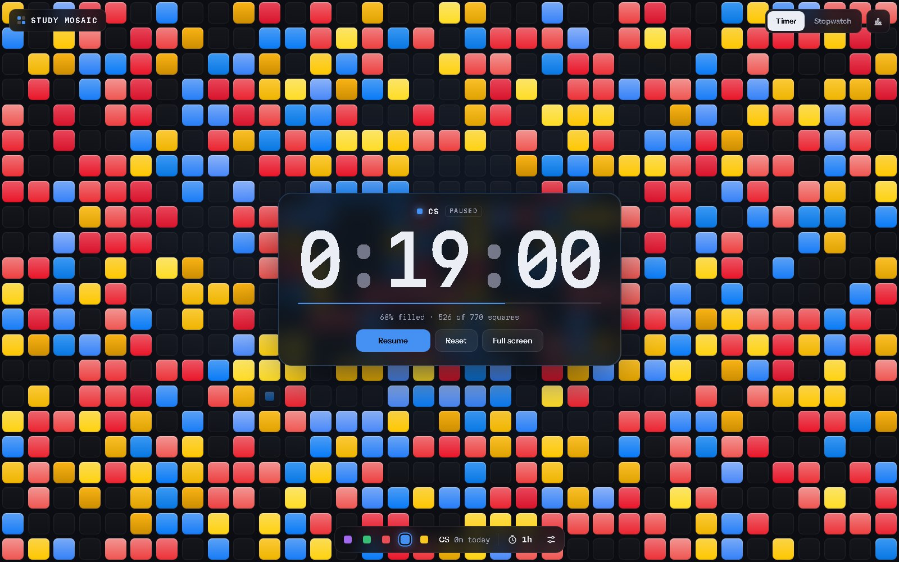
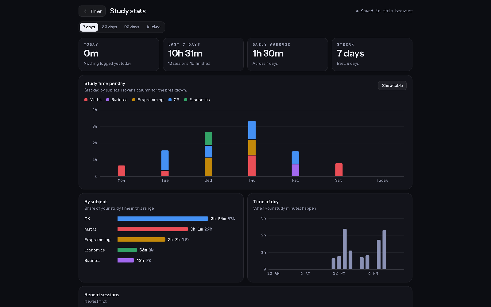

<div align="center">

# Study Mosaic

**A study timer that fills your screen with a mosaic of coloured squares as you work.**

[**Open the app**](https://anish-achar.github.io/study-mosaic/)




</div>

---

## The idea

A countdown on its own is easy to ignore. In Study Mosaic, every few seconds of focus adds one square to the screen, in the colour of the subject you're studying. By the end of a session the whole screen is filled, and you can see at a glance how the time was split.

## Features

- **Timer or stopwatch.** Pick a preset (15, 25, 45, 60, 90 or 120 minutes) or set your own length.
- **Colour per subject.** Maths, CS, Programming, Business and Economics. Switch subject mid-session and the new squares take the new colour.
- **Make it yours.** Four fill patterns (Scatter, Rise, Sweep, Bloom), three square sizes and an optional chime.
- **Full-screen focus mode.** Only the squares and the time stay on screen (`F` to toggle, `Space` to start or pause).
- **Picks up where you left off.** Reload or close the tab and the timer carries on. The screen is kept awake while it runs.
- **Study stats.** Totals for today, the last 7/30/90 days or all time, your daily average and streak, study time per day stacked by subject, a by-subject split, time of day, and a session log.


<p align="center"><sub>The stats page, shown here with demo data</sub></p>

## Run it

It's one HTML file with no build step and no libraries.

```bash
git clone https://github.com/Anish-Achar/study-mosaic.git
```

Then open `index.html` in any modern browser, or use the [hosted version](https://anish-achar.github.io/study-mosaic/).

## Privacy

Sessions are saved in your browser's `localStorage`. Nothing is sent anywhere, so clearing your browser data clears your history.

## Built with

- Vanilla JavaScript and the Canvas 2D API, with every square drawn and animated in code
- Inline SVG charts for the stats page
- Web Audio for the chime, and the Screen Wake Lock and Fullscreen APIs

---

<sub>Built by <a href="https://anishachar.com">Anish Achar</a>. Part of my <a href="https://github.com/Anish-Achar">portfolio</a>.</sub>
